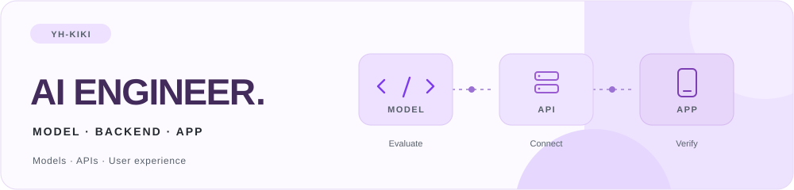
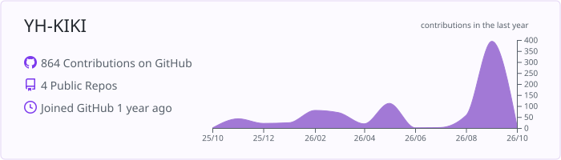
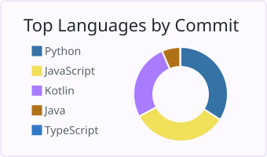
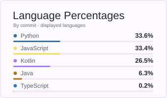

<h1 align="center">
  <picture>
    <source media="(max-width: 600px)" srcset="./assets/title-mobile.svg" />
    
  </picture>
</h1>

[About](#-about-me) · [GitHub](#-github-statistics) · [Skills](#-tech-stack) · [Projects](#-selected-projects)

## 🌿 About Me

플랫폼 운영과 QA에서 사용자 요구를 정리하고, 오류를 재현하며, 수정 결과를 확인해 왔습니다.  
이 경험을 바탕으로 AI 모델·데이터 검증과 백엔드·앱 연동을 함께 다룹니다.

- **Model & Data** · 보행 모델 비교, 대화 맥락 분류 데이터셋 설계, RAG 검색 평가
- **Service Integration** · 비동기 분석 처리, API 응답 계약, 데이터 정합성과 예외 처리
- **Teamwork** · 요구사항·API 명세 정리, 팀 프로젝트 리딩, 사용자 흐름 검증

## 📊 GitHub Statistics

  

  
  

공개 활동을 바탕으로 갱신합니다. 백분율은 왼쪽 차트에 표시된 언어를 기준으로 계산하며, 기술 숙련도를 뜻하지 않습니다.

## 🛠 Tech Stack

### AI · ML · LLM

  
  
  
  
   
  
  
  
  

모델 비교 · 데이터셋 설계 · Fine-tuning · 문맥 의존성 점검 · 검색 평가

### Backend

  
  
  
  
  
  

REST API · 비동기 분석 워커 · 상태 전이 · AI 응답 처리

### Data · Infra

  
  
  
  
  
  

벡터 검색 · 트랜잭션 · 컨테이너 간 연동 · 프록시 경로 오류 점검

### Web

  
  
  
  

사용자·관리자 화면 · API 연동 · 검색 결과와 기록 흐름 구현

### Android

  
  
  

분석 완료 확인 · 알림에서 결과 복귀 · 공동 돌봄과 권한별 동작

### Collaboration

  
  

API 명세 · 역할 분담 · 일정 조율 · 재현 조건과 검증 결과 공유

## 🚀 Selected Projects

### 🐾 댕스 DAENGS

**반려견 보행 기록과 공동 돌봄 Android 서비스**  
`2026.08–09` · `5인 팀` · 보행 모델 비교·연동 / Android / 분석 워커 전환

- 모델 조합 **5종 비교** 후 SSDLite + RTMPose-m 선정, 분석을 **Celery·Redis 워커**로 분리
- WorkManager로 **분석 요청 → 완료 알림 → 결과 카드** 연결, 공동 돌봄·권한별 동작 구현

[Backend · AI ↗](https://github.com/SAJOYO/DAENGS_dev) · [Android ↗](https://github.com/SAJOYO/DAENGS_APP)

<b>담당 범위와 문제 해결 더 보기</b>

- 후면 검출·뒷발 관절 정확도·처리 시간을 기준으로 모델 조합 비교
- 태스크 간 DB 엔진·이벤트 루프 충돌 수정, 분석 결과와 상태를 DB 기록에 연결
- 보호자 초대·공동 돌봄 구현, 서버가 반환한 권한값을 앱 표시와 동작에 적용
- 직접 호출과 프록시 호출을 비교해 업로드 413 오류의 외부 Nginx 제한 구간 특정
- 동일 대표 영상 약 13초·5fps에서 DLC 경유 대비 직접 호출의 포즈 처리 시간 **30초 → 15초**, 유효 프레임 **69/69 유지**

처리 시간은 해당 영상의 경로 비교 결과이며, 전체 영상의 처리 시간이나 진단 정확도를 의미하지 않습니다. 앱의 권한 반영을 담당했고 서버 측 권한 검증은 서버 팀의 담당 범위였습니다.

### 💬 커리어지키미

**대화 맥락에 맞지 않는 메시지를 전송 전에 알려주는 서비스**  
`2026.07–08` · `2인 팀` · 데이터셋 구축 중심 / 모델 학습·평가 참여

- 대화 데이터를 약 **100건 → 1,000건**으로 확장하고, 같은 답변에 다른 맥락을 짝짓는 구조로 재설계
- `pair_id` 기준 학습·검증 분리, **history 교체·response-only 실험**으로 문맥 의존성 점검

[Repository ↗](https://github.com/Bomb-pod/career-jikimi)

<b>데이터 설계와 평가 더 보기</b>

- 반복 문장·화자 구조 오류를 검수하고 적절·부적절 비율 유지
- 동일 response에 적절·부적절 history를 붙여 문장만 외워 맞히는 평가를 줄이도록 설계
- 한국어 사전학습 인코더 기반 Cross-Encoder 분류 모델의 학습·평가 참여
- Precision·Recall·팝업률을 함께 검토해 전송 전 오경고 기준 논의

### 🥗 냠냠플래닛 YummyPlanet

**보유 재료 기반 레시피 추천과 식단 관리 웹 서비스**  
`2026.04–05` · `3인 팀` · 팀 리더 PM / 풀스택 / AI 연동

- **DB가 후보를 선정하고 LLM이 설명을 생성**하도록 역할 분리, AI 호출·파싱 실패 시 대체 응답 처리
- 냉장고 추천 UI·API, 식단 기록·수정, 음식·식단·레시피 즐겨찾기 구현

[Repository ↗](https://github.com/YH-KIKI/YummyPlanet)

<b>서비스 구현과 연동 더 보기</b>

- React → Spring Boot → FastAPI의 요청값·경로·응답 스키마를 대조해 연동 오류 수정
- 식단 저장과 일일 칼로리 갱신을 트랜잭션으로 처리
- 추천 JSON 응답의 형식·길이·태그 수를 프롬프트로 지시하고 파싱·기본값 처리
- REST API 명세·역할·일정을 정리하고 Docker 환경에서 서비스 간 연동과 화면 반영 확인

### 🏥 바로닥큐

**병원·약국 검색과 예약을 연결하는 웹 서비스**  
`2026.02–03` · `5인 팀` · 팀 리더 PM / 풀스택 / 사용자·관리자 핵심 기능 개발 주도

- 병원·약국 검색·상세·지도와 **예약·길찾기로 이어지는 흐름** 구현
- 회원·병원·예약 관리의 화면·API·DB 연동, **운영시간 표시·예약 상태·401 처리** 보완

[Backend ↗](https://github.com/odorable-code/barodocq-backend) · [Frontend ↗](https://github.com/odorable-code/barodocq-frontend)

<b>구현 범위와 오류 대응 더 보기</b>

- Spring Boot Controller–Service–DAO, MyBatis SQL과 DTO 매핑 구현
- 공공데이터 CSV를 MySQL에 적재하고 누락값·표시 형식 정규화
- 목록 조회·페이지네이션, 후기·Q&A 관리 화면과 예외 처리 개선
- 자정 경과·24시간 운영정보의 표시 조건과 관리자 경로의 401 응답 처리 보완
- 인증된 병원 ID와 예약 상태를 기준으로 조회·승인·취소 범위 제한

## 🔎 Learning & Experiments

### RAG Demo

`2026.08` · 팀 전원이 각자 전체 파이프라인을 구현한 학습 프로젝트

- **문서 청킹 → 임베딩 → pgvector 적재 → 검색 → LLM 응답**까지 직접 구성
- e5·BGE-M3·Qwen3-Embedding·pplx-embed의 **유래 문서 재검색 지표와 질문 임베딩 지연** 비교
- 청크 단위 채점을 문서 단위로 바꾸어 다시 측정하고, Next.js 데모에서 검색·응답 확인

[Repository ↗](https://github.com/YH-KIKI/rag_demo)

## ☘ How I Work

문제가 생기면 발생 화면과 재현 조건부터 확인합니다.  
요청·응답과 데이터를 대조해 원인을 좁히고, 수정 뒤에는 사용자가 실제로 거치는 흐름까지 다시 확인합니다.  
팀 작업에서는 API 계약과 담당 범위를 명확히 정리하고, 구현한 내용과 검증한 범위를 구분해 기록합니다.
